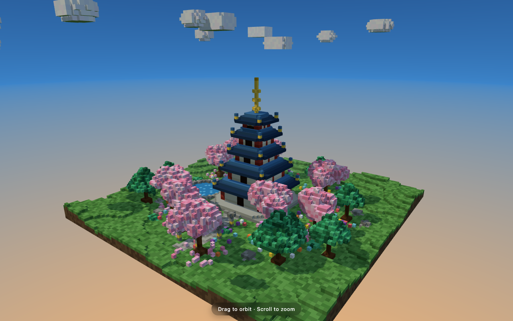

# DeepSeek-V4.1-Flash DERISKED (Blackfrost) — EXL3 2.9bpw on 2× DGX Spark

Quantizing [Blackfrost-AI/DeepSeek-V4.1-Flash-1017-DERISKED-FP8](https://huggingface.co/Blackfrost-AI/DeepSeek-V4.1-Flash-1017-DERISKED-FP8) to EXL3 2.9bpw with exllamav3 on one Spark, repairing what the converter gets wrong, and serving it TP2 on two DGX Sparks with [Mia AI Lab's DeepSeek-V4.1-Flash-EXL3-2x-DGX-Sparks kit](https://github.com/MiaAI-Lab/DeepSeek-v4.1-Flash-EXL3-2x-DGX-Sparks). Everything below was measured on that deployment.

**Weights:** [raulwesche/DeepSeek-V4.1-Flash-1017-DERISKED-EXL3-2.9bpw](https://huggingface.co/raulwesche/DeepSeek-V4.1-Flash-1017-DERISKED-EXL3-2.9bpw) (204 GB, 41 shards + 2 graft shards)

## Result

Spark-Bench v7.0 (commit `509759f`), thinking **off**, uncapped (600K window), temperature 1.0, top-p 0.95, 80 scenarios × 2 seeds (2001–2002), single run. Same contract as the stock-1017 row.

| domain | Blackfrost DERISKED 2.9bpw | stock 1017 EXL3 2.9bpw (Mia) |
|---|---|---|
| **TrueScore** | **88.0** | 88.6 |
| agentic | 88.8 | 89.6 |
| code | 90.0 | 95.2 |
| instruction | 97.1 | 96.7 |
| long_context | 70.8 | 74.0 |
| long_gen | **69.1** | 51.1 |
| planning | 95.6 | 93.2 |
| robustness | 87.7 | 93.4 |
| safety | 77.7 | 86.8 |
| tool_use | 75.6 | 82.9 |
| visual (HTML/Three.js) | 69.5 | 89.2 |
| classification · composition · structured | 100 | 100 |

Speed (TP2, DSpark k=5, from `oct17/speed_probe.py`): 26.4 tok/s prose · 43.1 code · 45.3 count · TTFT ~0.3 s · 32K prefill ~1,150 tok/s. Pagoda-garden Three.js prompt with thinking on: 30,727 completion tokens (23.9K reasoning) in 831 s, 37.2 tok/s average, rendered clean on the first try.



Read: derisking does what the card says. Refusals drop (safety −9), long-form output goes up (+18), and code / tool-use / visual pay for it. The visual row is text-only output — this quant has no vision tower.

## Hardware

- Quant: 1× DGX Spark (GB10, 128 GB), ~43 h for 2.9bpw with `-cbs 8`, 440 GB free NVMe (FP8 source 170 GB + work dir + output).
- Serve: 2× DGX Spark, ConnectX-7 over a 200 Gb switch (`10.10.10.x` fabric), head `spark-b610`, worker `spark-78f1`. Weights local on both (no NFS in the hot path).

## 1. Quantize

exllamav3 upstream does not convert DeepSeek V4.1 Flash. We used [vcruz305/exllamav3](https://github.com/vcruz305/exllamav3) @ `475461e9` (Cruz's fork, which has the V4.1 architecture) plus the patch in `tools/exllamav3-dsv41-convert.patch`. The patch fixes four things the fork still gets wrong on this checkpoint:

| failure | cause | fix |
|---|---|---|
| `No tensors found for layers.20.attn.compressor.wgate` | ratio-1 CSA layers have no `wgate` | create it only when present; uniform gate fallback |
| `Required tensor hc_head_fn not found` | Blackfrost omits top-level `hc_head_fn/_base/_scale` | derive the `HyperHead` pre-mix from `layers.39.hc_ffn_*` |
| MTP expects experts `128..383` | converter assumes 384 MTP experts; model has 128, top-3 | read `dspark_n_routed_experts` / `dspark_num_experts_per_tok` from config |
| MTP `markov_head` name mismatch | model uses `embed/head` | map the names |

Command (`quant.sh`):

```bash
python convert.py -i $SRC -w $WORK -o $OUT \
  -b 3 -hq -hb 6 -mb 4 -vb 16 -eb 16 -ngb 16 \
  -ss 8192 -cd conversion/standard_cal_data -v
# resume after any crash: python convert.py -r -w $WORK -cbs 8 -cdn 1 -v
```

`EXL3_HC_FOLD=0`, `expandable_segments:False`, `CUDA_DEVICE_MAX_CONNECTIONS=1` in the env — see `quant.sh`. Output: 3.02 bpw average, 6-bit head, 4-bit MTP, 41 shards.

## 2. Repair the converted tree

The output is not loadable by Mia's kit as-is. `tools/fix_blackfrost_tree.py <tree> <donor-1017-exl3> <engram-dir>` applies five repairs and verifies them (`leftover/missing: 0`):

1. **Config layout.** The converter flattens `text_config`; vLLM's `DeepseekV41Config` needs the nested layout. Restored from the source's config, kept the EXL3 `quantization_config`.
2. **Missing Engram and ratio-1 indexer tensors.** The converter skips the Engram tables (layers 1, 14) and the ratio-1 "hca" DSA indexers (layers 20, 24, 28, 32, 36 — it only handles ratio-2 "csa"). These are byte-identical between Blackfrost's FP8 and stock 1017 FP8, so they are grafted from Mia's 1017 EXL3 into `model-graft-1017.safetensors`.
3. **Phantom tensors.** 44 `attn.compressor.ape` / `ffn.gate.bias_vl` tensors the kit's loader has no mapping for. Removing them from the index is not enough — vLLM iterates every tensor in the shards — so the 40 affected shards are rewritten (streamed, no full-shard RAM).
4. **Padded CSA compressors.** On layers 2, 8, 14 the fork quantized `compressor.wkv/wgate` at 1024 wide instead of 512 (an "overlapping" bug). The runtime asserts on the shape during the first forward. Replaced with the donor's 512-wide modules in `model-graft-compressor.safetensors`.
5. **K-map.** `exl3_k_map.json` tells the kit the per-layer expert K. Linear-layer K mismatches self-correct on load; MoE experts need the map.

~5% of attention-path tensors end up from the stock-1017 quant. Experts, shared experts, main attention, head and MTP are Blackfrost's.

## 3. Serve (Mia kit, TP2)

Clone Mia's kit to the head, copy `env/dsv41-recipe.env` to `.env` and adjust paths. The settings that differ from Mia's default:

```
MODEL_HOST=/home/raulwesche/models/blackfrost-exl3-2.9bpw
ENGRAM_DIR=/home/raulwesche/models/dsv41-1017-engram-slim   # stock 1017 shards 47-48 + config + index
EXPECTED_SHARDS=41
KMAP_HOST=/home/raulwesche/models/blackfrost-exl3-2.9bpw/exl3_k_map.json
SERVED_MODEL_NAME=Blackfrost-DSv4.1-Flash-EXL3-2.9bpw
LANGUAGE_MODEL_ONLY=1        # no vision tower in the quant
WEIGHT_SYNC=nfs SKIP_SYNC=1  # weights pre-copied to the worker with rsync
```

Then `SKIP_BUILD=1 SKIP_SHIP=1 ./start.sh`. Both ranks load in ~5 min from page cache; the kit's warm-up request is the real test — every repair above was found by a warm-up failure.

Worker gotcha: the kit expects `ENGRAM_DIR/config.json` and `model.safetensors.index.json` on the worker too, not just the two Engram shards.

## Why there is no TP4 / 4.8bpw row

A 4.8bpw of the same model (317 GB) exists and needs four Sparks. It cannot run TP4: `moe_intermediate_size` is 2304, which splits to 576 per rank, and the EXL3 reconstruct kernel requires output dims divisible by 128 (TP2 → 1152 is fine). Expert-parallel or pipeline-parallel would need new code in the kit; DSpark speculative decoding is incompatible with PP in vLLM. We stopped there.

## Files

- `tools/exllamav3-dsv41-convert.patch` — against vcruz305/exllamav3 @ 475461e9
- `tools/fix_blackfrost_tree.py` — tree repair + verification
- `quant.sh` — the exact convert command
- `env/dsv41-recipe.env` — the `.env` that served the benchmark (Mia kit, comments stripped)
- `exl3_k_map.json` — per-layer K map shipped with the weights
- `bench/` — Spark-Bench run script and raw CSV for both rows

## Credits

DeepSeek for the model. Blackfrost AI for the derisked build. Mia AI Lab (Mia, Victor, Tony) for the 2-Spark EXL3 kit and the stock 1017 quant used as the donor. Cruz (@ViC305) for the exllamav3 fork with the V4.1 architecture. turboderp for exllamav3.

Results, more recipes: [wesche.com/lab](https://wesche.com/lab) · [github.com/Weschera](https://github.com/Weschera)
